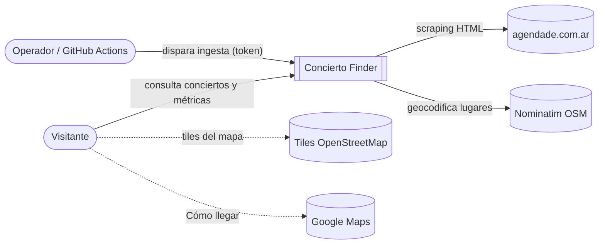
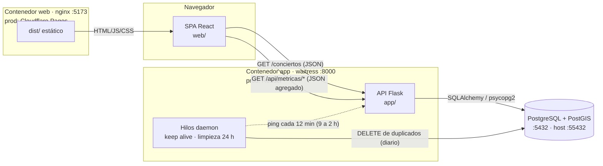
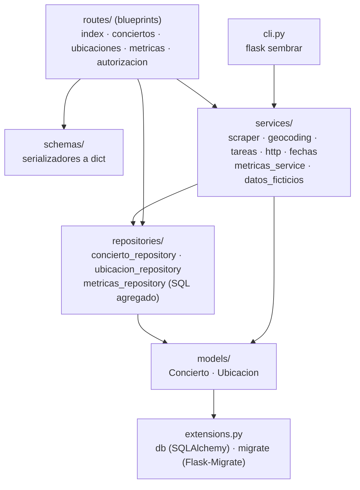
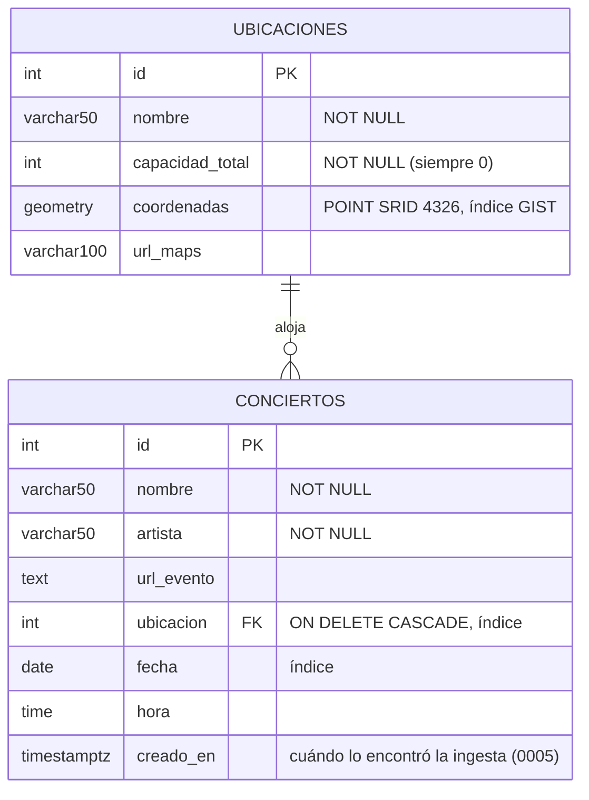
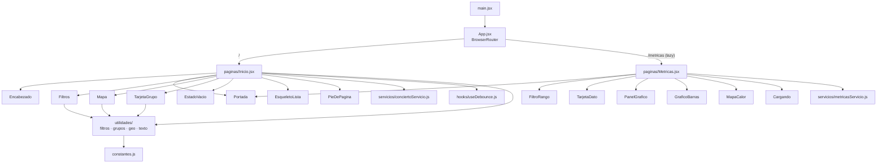
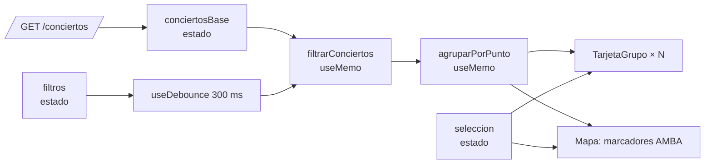
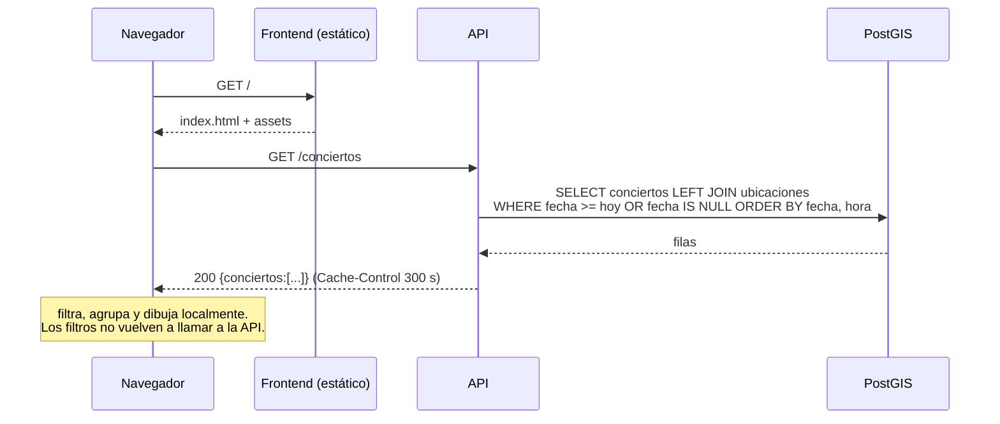
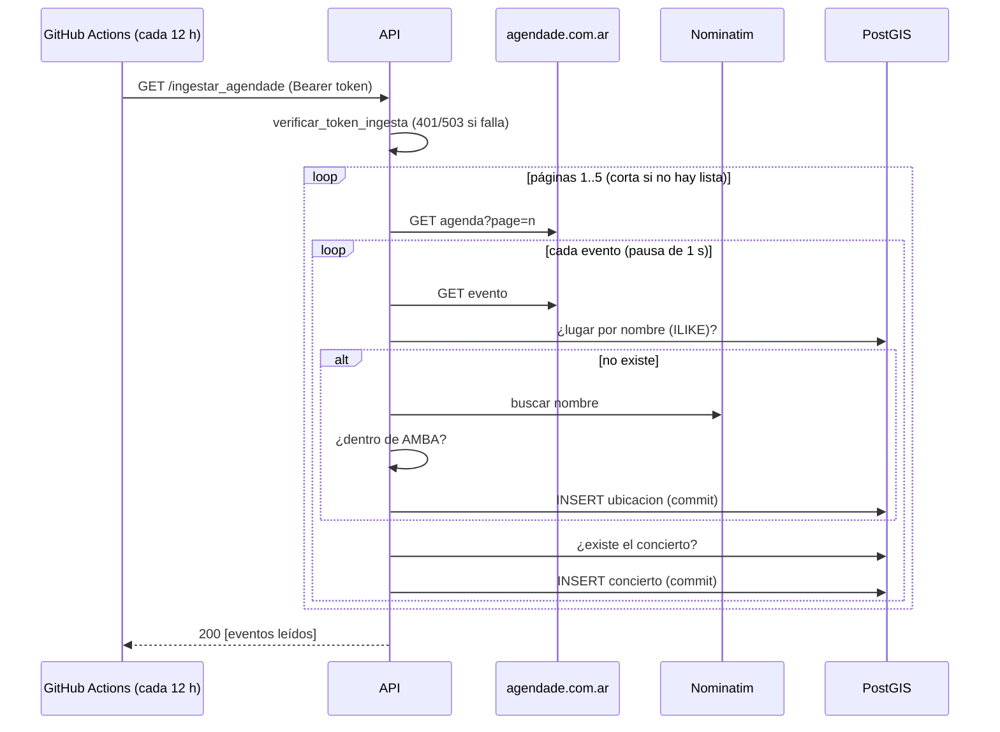
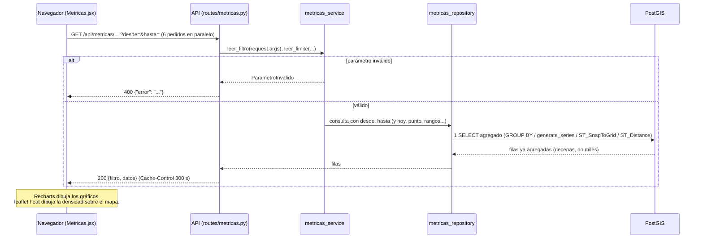

# Arquitectura — Concierto Finder

> Documento obtenido por **ingeniería inversa** del código (octubre 2026). Los requisitos que
> esta arquitectura implementa están en [REQUISITOS.md](REQUISITOS.md); el contrato HTTP, en
> [API.md](API.md); el despliegue y la operación, en [OPERACION.md](OPERACION.md).

## 1. Vista general

Aplicación web de dos piezas, más una base geoespacial:

- **Frontend SPA** (React 18 + Vite + Leaflet) con dos páginas: **Conciertos**, que descarga
  todos los conciertos vigentes una vez y hace el filtrado, el agrupamiento y el mapa en el
  navegador, y **Métricas**, que pide resultados ya agregados a la API y los dibuja con Recharts y
  un mapa de calor (leaflet.heat).
- **API REST** (Flask 3 + SQLAlchemy 2.0 + GeoAlchemy2, servida con waitress), de solo lectura
  para el público, con endpoints de métricas calculadas en SQL/PostGIS, un endpoint protegido de
  ingesta (scraping) y tareas en segundo plano.
- **PostgreSQL 16 + PostGIS 3.4** con dos tablas.

### 1.1 Contexto (C4 nivel 1)

### 1.2 Contenedores (C4 nivel 2)

| Contenedor | Tecnología | Producción | Local (`docker compose`) |
|---|---|---|---|
| web | React 18, Vite 7, react-router 7, react-leaflet 4, Recharts 3, leaflet.heat, nginx | Cloudflare Pages (`conciertosfinder.pages.dev`) | servicio `web` en :5173 |
| app | Python 3.12, Flask 3, SQLAlchemy 2.0, GeoAlchemy2, waitress | Render (`concierto-finder.onrender.com`) | servicio `app` en :8000 |
| db | PostgreSQL 16 + PostGIS 3.4 | — | servicio `db`, volumen `pgdata`, host :55432 |

## 2. Backend (`app/`)

### 2.1 Capas

| Módulo | Responsabilidad |
|---|---|
| `__init__.py` | `create_app()`: config, CORS, SQLAlchemy, Flask-Migrate, blueprints, 503 ante `TimeoutError` del pool, `session.remove()` al cerrar cada pedido. |
| `main.py` | Entrypoint de producción: configura `logging`, crea la app y **arranca los hilos de fondo**. |
| `config.py` | Lee `DATABASE_URL` (obligatoria, falla al importar si falta), `SCRAPER_TOKEN` y las opciones del pool. |
| `routes/` | HTTP. `autorizacion.py` define `verificar_token_ingesta()`, que la ruta de ingesta llama antes de empezar. `metricas.py` (prefijo `/api/metricas`) convierte `ParametroInvalido` en un 400. Las rutas no contienen consultas ni validaciones. |
| `cli.py` | Comandos de consola (`flask --app app sembrar`): datos ficticios para desarrollo. |
| `repositories/` | **Todas** las consultas: listados de vigentes con `joinedload` y orden por fecha, búsqueda espacial `ST_DWithin`, existencia y borrado masivo de duplicados. Las funciones de listado reciben `hoy` como parámetro. |
| `schemas/` | Serialización manual a dict/JSON (`[lng, lat]`, fechas ISO o `null`). |
| `services/scraper_service.py` | Ingesta: descarga, parseo, resolución de lugar, deduplicación y alta. |
| `services/geocoding_service.py` | Nominatim y la regla de región AMBA (fuente de verdad de los límites). |
| `services/tareas.py` | Hilos `mantener_despierta` (keep alive dentro de una franja horaria, o mientras corre una ingesta), `programar_limpieza_diaria` e `ingesta_inicial` (solo si la base está vacía). |
| `services/http.py` | `requests.Session` compartida y timeout por defecto. |
| `services/metricas_service.py` | Lee y valida los parámetros de las métricas (fechas, límite, celda, punto, rangos), aplica los valores por defecto y llama al repositorio. |
| `repositories/metricas_repository.py` | Las seis consultas de métricas en SQL: `GROUP BY`, `generate_series`, `mode()`, `ST_SnapToGrid`, `ST_Distance` sobre `Geography`. Todas comparten el filtro de fechas con parámetros enlazados. |
| `services/datos_ficticios.py` | Generador determinístico de conciertos ficticios (con estacionalidad) para desarrollo. |
| `services/fechas.py` | `hoy_argentina()` / `ahora_argentina()`: la fecha y la hora en `America/Argentina/Buenos_Aires` (el servidor corre en UTC). |

### 2.2 Modelo de datos

- Coordenadas en **WGS84 (SRID 4326)**, orden `[lng, lat]` en WKT y en el JSON.
- Las búsquedas por distancia castean a `Geography` para medir en metros.
- El esquema se versiona en `migrations/` (Alembic). `0001_esquema_inicial` es idempotente
  (no recrea tablas existentes); `0002_url_evento_text` amplía `url_evento` a `TEXT`;
  `0003_historial_conciertos` agrega índices sobre `conciertos.fecha` y `conciertos.ubicacion`;
  `0004_seguridad_rls` habilita RLS en las tablas de `public` y quita los permisos a los roles de la
  Data API de Supabase (ver D-13); `0005_creado_en` agrega `conciertos.creado_en` (cuándo lo
  encontró la ingesta). Se agrega sin valor por defecto y después se le pone `now()`: así las filas
  anteriores quedan en `null` en lugar de recibir la fecha de la migración.
- **Historial:** los conciertos pasados se conservan. "Vigente" no se guarda: se calcula en cada
  consulta con `fecha >= hoy OR fecha IS NULL` (ver D-8).

### 2.3 Concurrencia y recursos

- waitress atiende con un pool de hilos (4 por defecto). Una ingesta ocupa uno durante varios minutos.
- SQLAlchemy usa un pool de 3 conexiones + 2 de desborde, con `pool_pre_ping` y reciclado cada 30 min.
- Al importar `app.main` se levantan dos hilos daemon **por proceso**. Con varios workers
  la limpieza correría duplicada (es idempotente, así que no rompe nada).
- `flask --app app ...` (migraciones, shell) usa `create_app()` y **no** arranca los hilos.

## 3. Frontend (`web/src/`)

Dos páginas con `react-router-dom` (`/` y `/metricas`); cualquier otra ruta redirige a `/`.
`Metricas` se carga con `React.lazy`: Recharts y leaflet.heat van en un archivo aparte que solo
se descarga al visitar la página. Recargar en `/metricas` funciona porque nginx (`try_files`) y
Cloudflare Pages (sin `404.html`) devuelven `index.html` en cualquier ruta.

**Flujo de datos de `Inicio`** (sin librería de estado):

- El estado se reduce a lo mínimo (`conciertosBase`, `filtros`, `seleccion`, `cargando`, `error`);
  la lista filtrada y los grupos se **derivan**, no se guardan.
- `Mapa` recibe los grupos ya calculados, usa un único `divIcon` y abre los popups mediante
  refs de `Marker`. Cada clic en "Ver en mapa" crea un objeto `seleccion` nuevo, así vuelve a
  enfocar aunque sea el mismo concierto.
- Estilos: CSS Modules co-ubicados (`<nombre>.module.css`) y variables globales en `index.css`.
- `Portada` es el encabezado común de las dos páginas (logo, título, descripción y datos
  destacados). Las pantallas de carga (`EsqueletoLista`, `Cargando`) usan `useDemorado` para
  avisar, pasados 4 s, que la API gratuita se está despertando.
- Mapa base: tiles de OpenStreetMap con un filtro CSS por tema (gris suave en el claro, invertido
  y azulado en el oscuro), definido una sola vez en `mapa.module.css` y reutilizado por `MapaCalor`.
  Se evaluó CARTO (Positron), más sobrio, pero desde 2026 exige una clave de API y sin ella muestra
  una marca de agua.
- Las fechas de la lista se arman en hora local con `utilidades/fechas.js` (`partesFecha`,
  `etiquetaCercania`), nunca con `new Date("YYYY-MM-DD")`.
- `VITE_API_URL` se fija en el build. Si falta, se usa la API de producción.

**Página `Metricas`.** El estado es el filtro (`periodo`, `desde`, `hasta`) y los datos. Cada cambio
de filtro pide en paralelo los seis endpoints (`Promise.all`). Mientras llegan, los datos anteriores
siguen a la vista, atenuados, y la respuesta de un pedido viejo se descarta.
- **Gráficos:** `GraficoBarras` (Recharts) dibuja columnas o barras horizontales de una sola serie.
  Los colores se aplican por CSS con las variables del tema (`--color-grafico`, validado contra la
  superficie de cada tema), no por props.
- **Mapa de calor:** `MapaCalor` reutiliza el contenedor, los tiles y el filtro oscuro de `Mapa`,
  y crea la capa de `leaflet.heat` con `useMap`. Usa una escala de un solo tono que cambia con el
  tema (lo detecta `useTemaActual`, que observa `data-tema`).

## 4. Flujos principales

### 4.1 Carga de la página

### 4.2 Ingesta

Los errores de un evento se loguean, se hace rollback y se sigue con el siguiente. Un error al
bajar una página de la agenda corta la corrida.

### 4.3 Limpieza diaria

Hilo `programar_limpieza_diaria`: al arrancar y luego cada 24 h ejecuta, en una transacción, un
`DELETE` de los duplicados (cuando hay otro con menor id y la misma identidad). Los conciertos
pasados **no** se borran: son el historial.

### 4.4 Página de métricas

## 5. Decisiones de diseño

| # | Decisión | Motivo | Consecuencia |
|---|---|---|---|
| D-1 | Filtrado en el cliente | Volumen chico. Respuesta instantánea y menos carga sobre una API gratuita que se duerme. | `/conciertos_cerca` queda sin uso; no escala a decenas de miles de eventos. |
| D-2 | PostGIS para coordenadas | Consultas espaciales nativas (`ST_DWithin`). | Requiere la extensión; los datos se guardan en un tipo geográfico real. |
| D-3 | Scraping en vez de API de terceros | La fuente no ofrece API. | Frágil ante cambios de HTML. |
| D-4 | Tareas en hilos del mismo proceso | Sin infraestructura extra (sin Celery ni cron del sistema). | Se duplican por worker; se pierden si el proceso se reinicia antes de las 24 h (la limpieza corre al arrancar). |
| D-5 | Serialización manual | Dos entidades; no justifica marshmallow. | Hay que mantener los serializadores a mano. |
| D-6 | Ingesta protegida con token compartido | Simple y compatible con crons que solo configuran una URL (`?token=`). | El token en la query puede quedar en los logs de proxies; se prefiere el header. |
| D-7 | Migraciones con Alembic y base idempotente | Versionar el esquema sin romper las bases creadas con `create_all()`. | Los cambios de modelo requieren `flask db migrate` y revisar el script. |
| D-8 | Historial con **vigencia derivada de la fecha** (en lugar de una tabla de archivados o una columna `estado`) | La regla de vigencia (RN-02) ya depende solo de la fecha: guardarla aparte duplicaría el dato y obligaría a un job que la mantenga al día. Una tabla de archivados duplicaría el esquema y haría que cada métrica necesite un `UNION`. | Todas las consultas públicas deben filtrar por fecha (está centralizado en `_consulta_vigentes`). La tabla crece sin límite: por eso los índices de la `0003`. |
| D-9 | Tests contra **PostGIS real** (contenedor descartable) en lugar de SQLite o mocks | Las consultas usan PostGIS (`ST_DWithin`, `Geography`) e `IS NOT DISTINCT FROM`: SQLite no las tiene, y un mock no prueba el SQL. El esquema se crea con las migraciones, así también quedan probadas. | Los tests necesitan Docker (o un PostgreSQL con PostGIS). Son algo más lentos que en memoria (≈ 2 s para toda la suite). |
| D-10 | **Métricas calculadas en SQL** (no en Python ni en el navegador) | Con el historial, la tabla crece sin límite. Agregar en la base trae solo decenas de filas; traer todos los conciertos para contarlos en Python crecería con el historial y ocuparía memoria y el pool. PostGIS además resuelve las distancias y la grilla del mapa de calor. | El SQL es más largo que un bucle en Python; por eso cada consulta está comentada y tiene tests con resultados calculados a mano. |
| D-11 | **Recharts** para los gráficos y **leaflet.heat** para el mapa de calor, con la página de métricas en un archivo aparte (`React.lazy`) | Recharts usa componentes de React y dibuja en SVG, así los colores se toman de las variables CSS del tema. leaflet.heat es el plugin estándar de mapas de calor de Leaflet, que el proyecto ya usa. | Más peso (≈ 114 kB gzip), pero solo para quien visita Métricas. leaflet.heat no se actualiza desde 2015: espera `L` global (`utilidades/leafletGlobal.js`) y escala la intensidad según el zoom (se corrige con `maxZoom`). |
| D-12 | Normalizar artistas con `translate(lower(trim(...)))` en vez de la extensión `unaccent` | No requiere instalar otra extensión en la base; cubre las vocales acentuadas, la ü y la ñ del español. | No normaliza acentos de otros idiomas (por ejemplo, "è"). Si hiciera falta, se cambiaría a `unaccent` con una migración. |
| D-13 | **RLS sin políticas** en las tablas de `public` y sin permisos para `anon` y `authenticated` (migración 0004) | En producción la base está en Supabase, que expone `public` por su propia API REST con una clave pública. La app no usa esa API: todo pasa por Flask. RLS sin políticas cierra esa puerta, y el dueño de las tablas (el usuario de Flask) no queda sujeto a RLS. | Si algún día se usara la Data API de Supabase desde el frontend, habría que escribir políticas explícitas. La migración solo toca tablas cuyo dueño es el usuario que la corre: `spatial_ref_sys` (PostGIS) puede quedar sin RLS; para eso conviene desactivar la Data API en el panel de Supabase. |

## 6. Deuda técnica y evolución sugerida

- Tests: ya hay tests de repositorios, rutas, tareas, parseo y migraciones contra PostGIS (`tests/`). Corren en CI (`.github/workflows/ci.yml`). Faltan el recorrido del scraper con HTML de ejemplo y las utilidades del frontend.
- Ampliar `ubicaciones.nombre` (50 caracteres) y matchear lugares por nombre exacto o normalizado en lugar de `ILIKE %x%`.
- Correr la ingesta fuera del pedido HTTP (cola o job programado), para no ocupar un hilo de waitress durante minutos.
- Unificar la ubicación de los límites de AMBA (por ejemplo, exponerlos por la API) para no mantenerlos duplicados.
