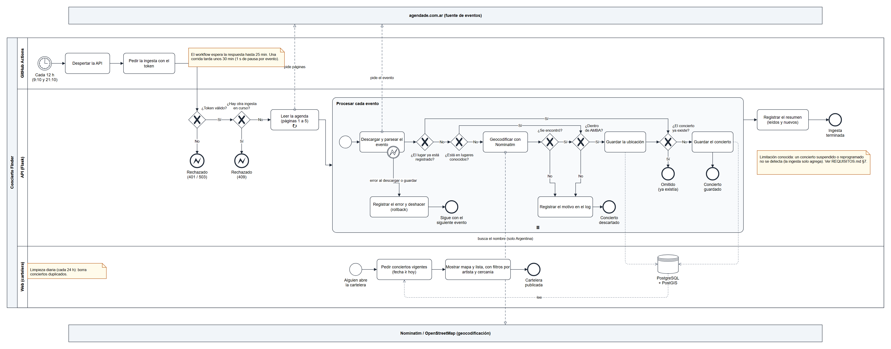
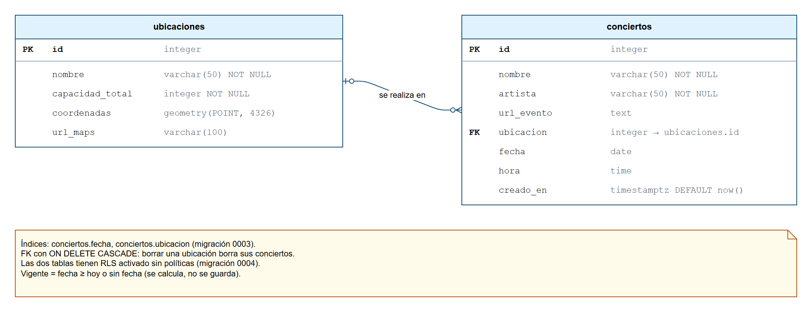

# Análisis funcional

Entregables de análisis de sistemas de Concierto Finder. Complementan la especificación
([REQUISITOS.md](REQUISITOS.md)) y la arquitectura ([ARQUITECTURA.md](ARQUITECTURA.md)).

| Entregable | Archivo | Estado |
|---|---|---|
| Relevamiento | [relevamiento.md](relevamiento.md) | Relevamiento documental completo (4 técnicas, 6 hallazgos, 1 requisito nuevo); entrevistas pendientes |
| Proceso de ingesta (BPMN) | [bpmn-ingesta.png](bpmn-ingesta.png) · editable: [bpmn-ingesta.drawio](bpmn-ingesta.drawio) | Terminado (proceso actual) |
| Modelo de datos (DER) | [der.png](der.png) · editable: [der.drawio](der.drawio) | Terminado |
| Casos de prueba de aceptación | [casos-de-prueba.md](casos-de-prueba.md) | 10 casos ejecutados el 25/10/2026: 10 pasaron |
| Especificación de requisitos (ISO/IEC/IEEE 29148) | [REQUISITOS.md](REQUISITOS.md) | Versión 2.0 |
| Matriz de trazabilidad | [trazabilidad.md](trazabilidad.md) | Terminada |
| Glosario y LEL | [glosario-lel.md](glosario-lel.md) | Terminado |
| Estado del arte | [estado-del-arte.md](estado-del-arte.md) | Terminado |
| Contrato frontend–backend | [contrato-api.md](contrato-api.md) · [openapi.json](openapi.json) | Verificado en CI |

Los `.drawio` se abren y editan en [app.diagrams.net](https://app.diagrams.net) o en draw.io desktop.

## Proceso de ingesta (BPMN)

Modela el proceso **tal como funciona hoy** (as-is), según el código de
`app/services/scraper_service.py` y `.github/workflows/ingesta.yml`.

- **Participantes.** El pool *Concierto Finder* tiene tres carriles: GitHub Actions (dispara el
  proceso), la API en Flask (lo ejecuta) y la web (publica el resultado). agendade.com.ar y
  Nominatim son participantes externos: se comunican con flujos de mensaje (líneas punteadas).
- **Disparador.** Evento de inicio temporizado, cada 12 h (RF-19).
- **Validaciones de entrada.** Dos compuertas exclusivas rechazan el pedido si el token no es
  válido (401/503, RF-20) o si ya hay una ingesta corriendo (409, RF-19 bis).
- **Subproceso "Procesar cada evento".** Es multi-instancia secuencial (marca ≡): se repite por
  cada evento leído, de a uno, con 1 s de pausa (RNF-07). Adentro:
  - *¿El lugar ya está registrado?* Si no, se buscan sus coordenadas: primero en la tabla de
    lugares conocidos y, si no está, en Nominatim (RF-22).
  - **Camino de error de la geocodificación:** si Nominatim no encuentra el lugar, o el punto cae
    fuera de AMBA (RF-23), el concierto se descarta y el motivo queda en el log.
  - *¿El concierto ya existe?* Si existe, se omite y así se evitan duplicados (RF-24, RN-03).
  - **Evento de error en el borde:** si falla la descarga o el guardado de un evento, se deshace
    la transacción y se sigue con el siguiente. Un evento con error no corta la ingesta (RNF-06).
- **Publicación.** La web no recibe un aviso de la ingesta: cuando alguien abre la cartelera, pide
  los conciertos vigentes a la base (RN-02).

**Limitación modelada como nota:** un concierto suspendido o reprogramado no se detecta, porque
la ingesta solo agrega conciertos (REQUISITOS §7). El relevamiento confirmó que es un problema real
(H5) y lo convirtió en el requisito nuevo RQ-05.

**Simplificación:** el diagrama muestra "leer la agenda" y "procesar cada evento" como pasos
sucesivos. En el código se intercalan: se lee una página, se procesan sus eventos y se pasa a la
siguiente. El resultado es el mismo, y el diagrama se lee mejor.

## Modelo de datos (DER)

Sale de los modelos de SQLAlchemy (`app/models/`) y de las migraciones de Alembic (`migrations/`).

- **Dos entidades:** `ubicaciones` (el lugar, con su punto geográfico) y `conciertos`.
- **Relación:** una ubicación tiene cero o muchos conciertos, y un concierto tiene cero o una
  ubicación (la clave foránea admite nulos). Si se borra una ubicación, se borran sus conciertos
  (`ON DELETE CASCADE`).
- **Sin tablas de artistas ni de historial, a propósito:**
  - el artista es un texto del concierto, y se normaliza al consultar (RN-11);
  - el historial son los mismos conciertos con fecha pasada, porque la vigencia se calcula y no se
    guarda (RN-02, decisión D-8 en ARQUITECTURA).

  Las dos alternativas se evaluaron y se descartaron por simplicidad.
- `creado_en` registra cuándo la ingesta encontró cada concierto (migración 0005) y alimenta las
  métricas de anticipación e ingesta.
